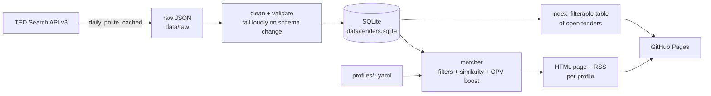

# tender-radar

[](https://github.com/Jenoyrex/tender-radar/actions/workflows/tests.yml)
[](https://github.com/Jenoyrex/tender-radar/actions/workflows/daily.yml)

Find EU public tenders that fit your small business.

You describe your business in a few sentences and set some filters (countries,
contract value, words to avoid). Every day tender-radar pulls new calls for
tender from TED, the EU's official procurement journal, ranks the open ones
by fit, and publishes a web page and an RSS feed for your profile. Each result
says why it matched.

**Live site: https://jenoyrex.github.io/tender-radar/**

It costs nothing to run: the TED API is free and needs no key, matching uses
small open-source models on CPU, and everything runs on GitHub Actions and
GitHub Pages.

## Pipeline



| Step | Code |
|---|---|
| Fetch notices per day, 250/page, retries, raw cache | [`ted.py`](src/tender_radar/ted.py) |
| Tidy rows, dedupe on notice id, schema checks | [`clean.py`](src/tender_radar/clean.py) |
| Storage | [`db.py`](src/tender_radar/db.py) |
| Filters, scoring, reasons | [`match.py`](src/tender_radar/match.py) |
| Pages and feeds | [`build.py`](src/tender_radar/build.py) |
| Evaluation | [`evaluate.py`](src/tender_radar/evaluate.py) |

What I found out about the API (field names, paging limits, quirks) is in
[docs/data-source.md](docs/data-source.md).

## Add your own profile

Create a YAML file in [`profiles/`](profiles) and open a pull request (or fork
the repo; the daily workflow runs on your fork too):

```yaml
name: Small web studio (Portugal & Spain)
description: >
  We design and build public-facing websites, portals and mobile apps on
  open-source CMS like WordPress and Drupal, with a focus on accessibility.
countries: [PRT, ESP]          # ISO alpha-3; leave empty for all of Europe
cpv: ["7241", "7221"]          # preferred CPV prefixes: small score boost
min_value_eur: 10000           # tenders with no published value are kept
max_value_eur: 750000
exclude_keywords: [hardware, impresoras]
```

The page appears at `https://jenoyrex.github.io/tender-radar/p/<file-name>.html`,
with the feed next to it at `.xml`.

**Scoring:** text similarity between your description and the tender's title +
description, plus 0.1 if one of the tender's CPV codes starts with one of your
prefixes. Expired tenders, other countries, values outside your range and
excluded words are filtered out first.

To follow another sector, change `cpv_prefixes` in [`config.yaml`](config.yaml)
(e.g. `["45"]` for construction).

## Run it locally

```bash
pip install -e ".[dev]"            # add ,embeddings for the sentence-transformers model
tender-radar update                # backfill the last 60 days from TED (~2 min)
tender-radar build                 # writes site/
tender-radar evaluate              # prints the evaluation tables (needs the embeddings extra)
pytest
```

## Evaluation

Using CPV codes as weak ground truth (the matcher never sees them), I tested
whether a profile built from one CPV group's tenders pulls that group to the top.
Precision@10, averaged over 11 IT sub-sectors:

| Method | A: profile = 10 sampled tenders | B: profile = one English sentence |
|---|---|---|
| Random ranking | 0.09 | 0.09 |
| TF-IDF words (baseline) | **0.25** | 0.16 |
| TF-IDF character 3-5-grams (**shipped**) | 0.22 | **0.21** |
| all-MiniLM-L6-v2 (English) | 0.20 | **0.21** |
| paraphrase-multilingual-MiniLM-L12-v2 | 0.15 | **0.21** |

The sentence-transformers models **did not beat TF-IDF**, so the site ships the
simpler character n-gram TF-IDF, which works across languages without PyTorch.
All methods are only 2–3× better than random. The full method, per-group numbers
and caveats are in [docs/evaluation.md](docs/evaluation.md).

## Limitations

- **Only tenders above the EU thresholds.** TED publishes contracts above the
  EU procurement thresholds (roughly €140k–€220k for services from central and
  local government) plus some voluntary notices. Most small, local contracts are
  only on national portals and are not here.
- **Value is often missing.** About 45% of notices publish no estimated value.
  They are kept (and labelled) rather than guessed. Non-euro values are converted
  with a fixed, rounded rate table, so treat the € figure as approximate.
- **Deadlines.** About 1% have no deadline in the API fields used; they are shown
  as "see notice".
- **Duplicates.** Buyers sometimes re-publish a call under a new notice number;
  pages keep only the newest per (buyer, title).
- **Unofficial.** This is a hobby project, not affiliated with the EU or TED.
  Always read the official notice before bidding.

## Running costs

Zero. The TED Search API is free and keyless. GitHub Actions minutes are free for
public repositories; a daily run takes a few minutes. The SQLite database and model
cache live in the Actions cache (rebuilt automatically if evicted); only a small CSV
snapshot of open tenders ([`data/open-tenders.csv`](data/open-tenders.csv)) is
committed each day, so the git history stays small.

## Data and licence

Tender data: **Source: [TED – Tenders Electronic Daily](https://ted.europa.eu),
© European Union, Publications Office of the EU**, reused under Commission
Decision 2011/833/EU. The same attribution appears on every generated page.

Code: [MIT](LICENSE).
