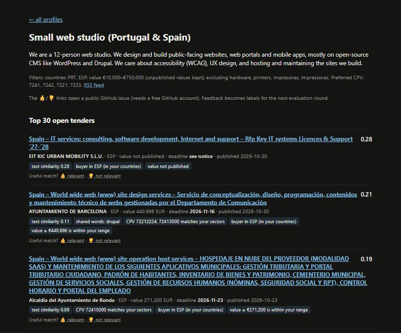
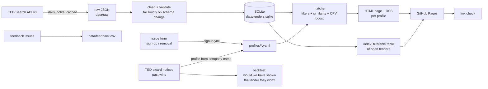

# tender-radar

[](https://github.com/Jenoyrex/tender-radar/actions/workflows/tests.yml)
[](https://github.com/Jenoyrex/tender-radar/actions/workflows/daily.yml)

A free daily shortlist of open EU public tenders for small IT companies. You
describe your business in a few sentences, or just give your company name and
tender-radar builds the description from your past EU contract wins. Every
morning it pulls new calls for tender from TED, the EU's official procurement
journal, drops the ones outside your countries and value range, ranks the rest
by how well they fit, and publishes a web page and an RSS feed for you, each
result with the reasons it matched. It runs entirely on free GitHub Actions and
GitHub Pages, with no server and no paid API.

**Live site: https://jenoyrex.github.io/tender-radar/** ·
**[Get my tender feed](https://github.com/Jenoyrex/tender-radar/issues/new?template=signup.yml)**



## Pipeline



| Step | Code |
|---|---|
| Fetch notices per day, 250/page, retries, raw cache | [`ted.py`](src/tender_radar/ted.py) |
| Tidy rows, dedupe on notice id, schema checks | [`clean.py`](src/tender_radar/clean.py) |
| Storage | [`db.py`](src/tender_radar/db.py) |
| Filters, scoring, reasons | [`match.py`](src/tender_radar/match.py) |
| Pages and feeds | [`build.py`](src/tender_radar/build.py) |
| Award notices, winner-name normalisation, entity resolution | [`awards.py`](src/tender_radar/awards.py) |
| Profile from a company's past wins | [`company.py`](src/tender_radar/company.py) |
| Award-notice backtest (main evaluation) | [`backtest.py`](src/tender_radar/backtest.py) |
| Older evaluations (CPV proxy, hand labels) | [`evaluate.py`](src/tender_radar/evaluate.py), [`evaluate_labels.py`](src/tender_radar/evaluate_labels.py) |
| Self-serve sign-up, removal, abuse limits | [`signup.py`](src/tender_radar/signup.py) |
| Feedback issues → CSV | [`feedback.py`](src/tender_radar/feedback.py) |
| Published-site link checker | [`linkcheck.py`](src/tender_radar/linkcheck.py) |
| Atomic UTF-8 file writes | [`util.py`](src/tender_radar/util.py) |

What I found out about the API (field names, paging limits, quirks) is in
[docs/data-source.md](docs/data-source.md).

## Get your own feed

Open the **[Get my tender feed](https://github.com/Jenoyrex/tender-radar/issues/new?template=signup.yml)**
form (needs a free GitHub account). Give a company name, a few sentences about
what you do, or both, plus countries and a value range. A bot (the
[`signup`](.github/workflows/signup.yml) workflow) checks the input, writes
`profiles/<name>-<issue>.yaml`, rebuilds the site, replies with your page and
RSS links, and closes the issue, usually within a few minutes. With a company
name, the profile is built from that company's past EU contract wins on TED
(`tender-radar profile-from-company "<name>"` does the same locally).

To delete it, open a
[removal request](https://github.com/Jenoyrex/tender-radar/issues/new?template=remove.yml)
with your sign-up issue number. Only the person who signed up (or a maintainer)
can remove a feed.

Privacy: issues are public. The profile file stores only what you typed, plus
the sign-up issue number and date; no GitHub username or other personal data.

### Sign-up limits

To keep the service free (GitHub Actions minutes) and spam-free, the bot
rejects a sign-up, with a polite explanation, when:

| Limit | Value | Why |
|---|---|---|
| Active feeds per GitHub account | 1 | Checked against your own sign-up issues; remove the old feed first. |
| New sign-ups per day (everyone) | 20 | Caps a burst of automated sign-ups. |
| Feeds in total | 200 | Keeps the daily build well inside free limits. |
| GitHub account age | ≥ 7 days | Throwaway accounts are the usual spam source. |
| Content | description of 8+ words and at most 1,500 characters, no links, known countries, whole-euro values | Input validation. |

Requests are processed one at a time (one GitHub concurrency group), and every
run handles **all** open requests oldest first, so two sign-ups can never race
each other's commits and none is lost if GitHub drops a queued run. A run every
6 hours picks up anything missed. The limits live in
[`signup.py`](src/tender_radar/signup.py).

## Add a profile by pull request

Or create a YAML file in [`profiles/`](profiles) yourself and open a pull request
(or fork the repo; the daily workflow runs on your fork too):

```yaml
name: Small web studio (Portugal & Spain)
description: >
  We design and build public-facing websites, portals and mobile apps on
  open-source CMS like WordPress and Drupal, with a focus on accessibility.
countries: [PRT, ESP]          # ISO alpha-3; leave empty for all of Europe
cpv: ["7241", "7221"]          # preferred CPV prefixes: small score boost
min_value_eur: 10000           # tenders with no published value are kept
max_value_eur: 750000
exclude_keywords: [hardware, impresoras]
```

The page appears at `https://jenoyrex.github.io/tender-radar/p/<file-name>.html`,
with the feed next to it at `.xml`.

**Scoring:** text similarity between your description and the tender's title +
description, plus 0.1 if one of the tender's CPV codes starts with one of your
prefixes. Expired tenders, other countries, values outside your range and
excluded words are filtered out first.

To follow another sector, change `cpv_prefixes` in [`config.yaml`](config.yaml)
(e.g. `["45"]` for construction).

## Run it locally

```bash
pip install -e ".[dev]"            # add ,embeddings for the sentence-transformers models
tender-radar update                # fetch the last 60 days from TED (~2 min)
tender-radar build                 # writes site/
tender-radar profile-from-company "Example Software GmbH"   # print a profile YAML built from its TED wins
tender-radar history               # 2 years of award notices + 2.5 years of contract notices (~1.5 h, polite)
tender-radar backtest              # award backtest (needs the embeddings extra; --no-e5 skips that model)
tender-radar feedback              # collect relevant / not relevant issues into data/feedback.csv
tender-radar evaluate --labels     # older evaluation on hand labels
pytest && ruff check . && ruff format --check .
python -m tender_radar.linkcheck https://jenoyrex.github.io/tender-radar/
```

## Evaluation

Using CPV codes as weak ground truth (the matcher never sees them), I tested
whether a profile built from one CPV group's tenders pulls that group to the top.
Precision@10, averaged over 11 IT sub-sectors:

| Method | A: profile = 10 sampled tenders | B: profile = one English sentence |
|---|---|---|
| Random ranking | 0.09 | 0.09 |
| TF-IDF words (baseline) | **0.25** | 0.16 |
| TF-IDF character 3-5-grams (**shipped**) | 0.22 | **0.21** |
| all-MiniLM-L6-v2 (English) | 0.20 | **0.21** |
| paraphrase-multilingual-MiniLM-L12-v2 | 0.15 | **0.21** |

The sentence-transformers models **did not beat TF-IDF**, so the site ships the
simpler character n-gram TF-IDF, which works across languages without PyTorch.
All methods are only 2–3× better than random.

**Round 2** added 150 labelled (profile, tender) pairs (144 labelled by an AI, 6 by a
human) and a held-out dev/test split. TF-IDF on English titles + CPV labels,
multilingual-e5-small and a blend were tested: **none clearly beat the current
model on the test half** (P@10 0.27 for both current and the best challenger),
so nothing changed. The full method, both tables and caveats are in
[docs/evaluation.md](docs/evaluation.md).

## Limitations

- **Only tenders above the EU thresholds.** TED publishes contracts above the
  EU procurement thresholds (roughly €140k–€220k for services from central and
  local government) plus some voluntary notices. Most small, local contracts are
  only on national portals and are not here.
- **Value is often missing.** About 45% of notices publish no estimated value.
  They are kept (and labelled) rather than guessed. Non-euro values are converted
  with a fixed, rounded rate table, so treat the € figure as approximate.
- **Deadlines.** About 1% have no deadline in the API fields used; they are shown
  as "see notice".
- **Duplicates.** Buyers sometimes re-publish a call under a new notice number;
  pages keep only the newest per (buyer, title).
- **Unofficial.** This is a hobby project, not affiliated with the EU or TED.
  Always read the official notice before bidding.

## Running costs

Zero. The TED Search API is free and keyless. GitHub Actions minutes are free for
public repositories. Measured on 2026-11-14:

| Workflow | Runtime | How often |
|---|---|---|
| `daily` (fetch, feedback, build, deploy, link check) | 3 min 01 s ([run](https://github.com/Jenoyrex/tender-radar/actions/runs/43578321013)) | once a day |
| `signup` (validate, commit, rebuild via `daily`, reply) | 5 min 29 s ([run](https://github.com/Jenoyrex/tender-radar/actions/runs/43577844164)) | per sign-up batch, plus a sweep every 6 h (29 s when there is nothing to do, [run](https://github.com/Jenoyrex/tender-radar/actions/runs/43579747612)) |
| `tests` (ruff + pytest) | ~30 s | per push |

The SQLite database lives in the Actions cache (rebuilt from TED automatically if
evicted); only small CSVs ([`data/open-tenders.csv`](data/open-tenders.csv),
[`data/feedback.csv`](data/feedback.csv)) are committed each day, so the git history
stays small. The two-year backtest history is built locally and never committed.

## Data and licence

Tender data: **Source: [TED – Tenders Electronic Daily](https://ted.europa.eu),
© European Union, Publications Office of the EU**, reused under Commission
Decision 2011/833/EU. The same attribution appears on every generated page.

Code: [MIT](LICENSE).
